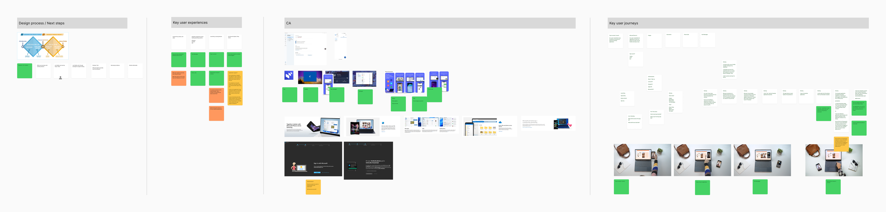
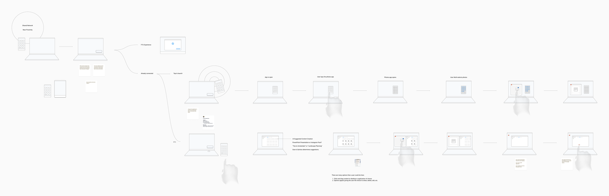
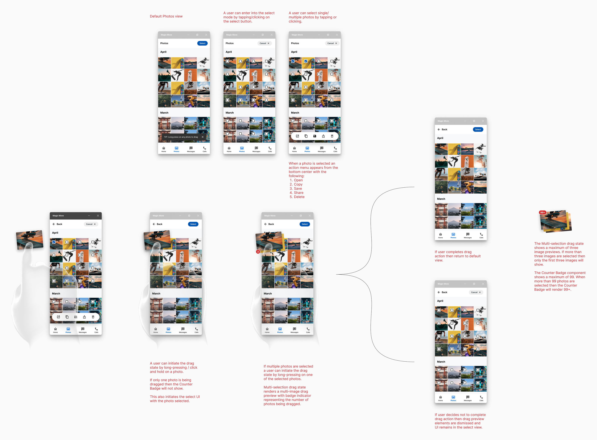

The hard part wasn’t moving files. It was removing every step between what someone meant to do and getting it done on the other screen. One idea, three names: Magic Move → Smart Share → Tap to Launch. The names changed; the interaction held.

## The challenge

Getting a photo from your phone to your PC was possible, but never effortless. In Smart Share research, most people emailed photos to themselves, and many used chat or cloud apps instead.

- **81%** used email to move photos from phone to PC
- **69%** used chat apps
- **69%** used cloud applications

We asked a different question:

> What if moving something between devices felt like physically handing it over?

<!-- TODO(mike): before/after journey image. Caption: "Before: email, chat, cloud, cable. After: phone, tap, PC." -->

## Impact

Smart Share launched on all 11 Aura Edition devices, then spread to consumer, commercial and all-in-one PCs. The tap became the main way in: most repeat launches skipped menus and shortcuts entirely. People who used it gave it a System Usability Scale score of 86, well above the average of 68.

## Collaboration

Magic Move sat between hardware, software and two outside partners, with teams spread across the US, China, Japan and Norway, so most of my job was keeping one experience intact across all of them. As the lead and primary designer, I owned the experience end to end, working with product management, hardware and software engineering, and our partners.

I presented the work regularly to our executive design director and to directors in product management and engineering, and it was shown to Lenovo’s CEO, Yang Yuanqing. The UX specification became the shared reference that kept those teams building the same thing.

## Defining the experience

We started with the experience, then wove in the technology, cost, and the hardware constraints of Lenovo PCs, iPhones and Android phones. Early work mapped user journeys and analyzed competitors. Then we envisioned how the tap should look and feel, and what it could do, focusing on three key experiences: Android, iOS and Windows apps that work as one; moving photos from phone to PC and back again; and Tap to Launch, where a simple tap of the phone against the side of the PC opens the app instantly.

Six principles kept us honest: clear, familiar, cross-platform, simple, trustworthy and secure.

<!-- TODO(mike): workshop material, sketches and 2–3 early Figma concepts. -->

<!-- TODO(mike): polished frames with captions 1 · Tap, 2 · Launch, 3 · Gallery, 4 · Drag, 5 · Transfer. -->

> The UI wasn’t the core idea. The interaction between the physical devices was the product.

## Designing beyond the screen

Magic Move couldn’t be designed as UI alone. A tap had to be sensed, recognized and answered: hardware sensing, Intel Unison, Elliptic Labs’ virtual tap, the tap target on the chassis, how the phone was held, and what each device was doing at the time.

I wrote the Magic Move UX specification to pin that down. It defined how the system should respond to a real-world gesture, and gave engineering one reference for building it and for arguing tradeoffs.

<!-- TODO(mike): annotated spec image. Caption: "Gesture → sensor → recognition → software response". -->

## Flows and experience mapping

I mapped the end-to-end flows for tap to launch, drag and drop, proximity detection, and sharing photos and links.

<!-- TODO(mike): what did the map change? e.g. the moment you cut a feature, reordered the flow, or found the first-run gap. -->

## Prototyping and research

We built a working prototype early: hold the phone near the laptop, and its photos appear on screen, ready to drag. Then we tested it across three studies and 37 participant sessions, each answering a different question.

1. **Will people understand the gesture?** Gorilla testing, Dec 2023, 6 sessions. People tapped at different angles, too lightly, or held the phone to the laptop like NFC. One worried about damaging the devices. The question became how to make the tap forgiving and teachable, so the design added tap guidance, success feedback, error recovery and first-use education.
2. **Does the interaction model work?** Magic Move usability study with UX researcher Peggy He, 2023, 15 hybrid workers and creatives. Tapping made the link between devices clearest, so it became the primary path, with F11 as the fallback. Drag and drop worked, but seven people clicked a photo before finding they could drag it, so discoverability became the priority. People moved photos in batches, so multi-select joined the core flow and the PC layout stopped mirroring the phone.
3. **What does it need for everyday use?** Smart Share study led by Antoniea Richardson, May 2024, 16 participants. “Tap the phone” was too vague without a demonstration, so onboarding got animated guidance. 15 of 16 wanted control over photo access while the phone was locked, so permissions and an on/off control moved into the core experience.

Research never told us to drop the gesture. It showed what had to surround it: guidance, feedback, bulk actions, a PC-native layout and trust controls.

<!-- TODO: the early-concept prototype film (0:40) and the Smart Share product film (0:53) need video support in Notes. -->

## Delivery

Smart Share shipped on 11 Lenovo Aura Edition PCs in September 2024. Through launch, I answered engineering’s questions as they came up and protected the hero use cases from drift or redirection.

<!-- TODO(mike): delivery image 4: make it or cut the slot. -->

## Outcome

The tap worked: it became how people opened Smart Share. The idea also outlived its first product, carrying into Lenovo Smart Connect as Tap to Launch. The same gesture also became Tap to Pair on Aura Edition PCs, connecting accessories like earphones, headsets and mice with a tap.
