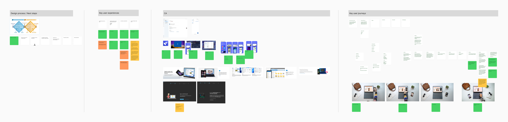
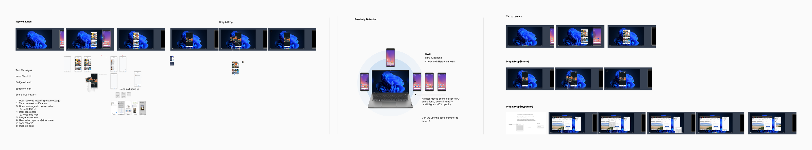
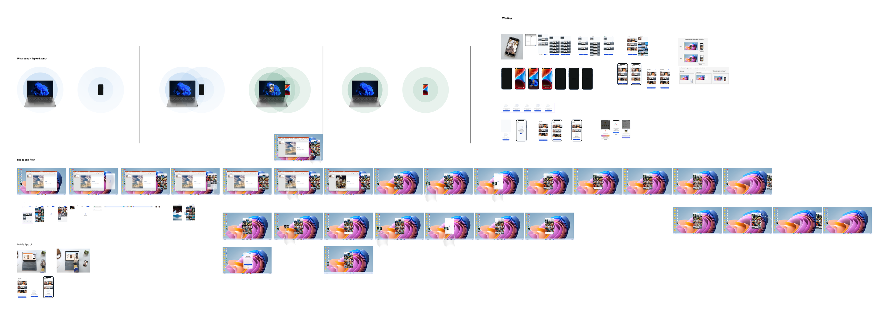
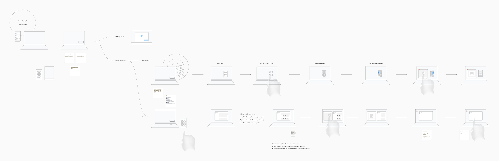
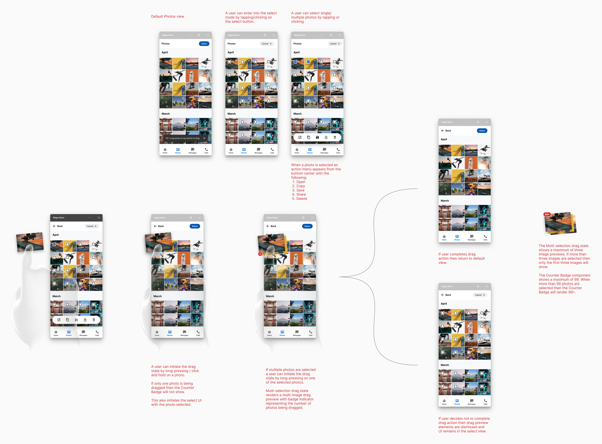
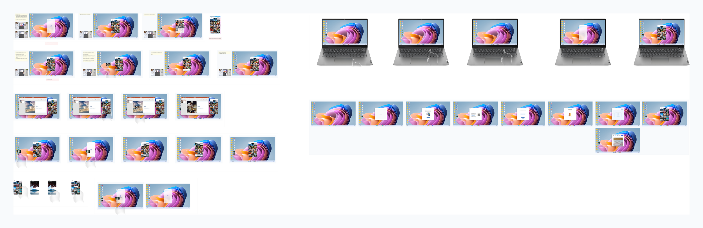

## The challenge

Moving content between a phone and PC was already possible, but rarely effortless.

People relied on email, chat, cloud storage, cables, and other workarounds. In later Smart Share research, 81% of participants used email for phone-to-PC photo transfer, while 69% used chat and 69% used cloud applications.

- **81%** used email to move photos from phone to PC
- **69%** used chat apps
- **69%** used cloud applications

We saw an opportunity to rethink the interaction entirely:

> Could moving between devices feel as natural as physically moving something from one place to another?

<!-- TODO(mike): before/after journey image (today's multi-step transfer vs. Phone → Tap → PC). -->

## Impact

- **~40%** of 1,484 Aura owners studied had used Smart Share
- **~70%** of active users engaged with it weekly
- **80–88%** of repeat launches came through the tap interaction
- **86** overall System Usability Scale score

Smart Share launched across an 11-device Aura Edition portfolio and later expanded to additional consumer, commercial, and all-in-one PCs. In a study of 1,484 Aura owners, roughly 40% had used Smart Share. Among active users, about 70% engaged with it weekly, and telemetry showed that 80% to 88% of repeat launches happened through the tap interaction rather than menus or keyboard shortcuts. The experience earned an overall System Usability Scale score of 86, while research also revealed an opportunity to improve feature awareness and first-use guidance.

<!-- TODO(mike): Collaboration: who you worked with (PM, engineering, hardware, research) and how you led the design team. -->

## Defining the experience

We started with the experience rather than the technology.

Early Magic Move work explored customer journeys, competitive experiences, physical Tap to Launch, photo sharing, drag and drop, links, messages, and calls. Our design principles emphasized clarity, familiarity, cross-platform support, simplicity, trust, and security.

<!-- TODO(mike): workshop material, sketches, 2–3 early Figma concepts, and 3–5 polished frames (tap, launch, gallery, drag, transfer). -->

> The UI wasn’t the core idea. The interaction between the physical devices was the product.

## Designing beyond the screen

Magic Move couldn’t be designed as UI alone.

The experience depended on hardware sensing, Intel Unison, Elliptic Labs’ virtual tap technology, physical tap targets, phone orientation, device state, and the software response to a real-world gesture.

I helped translate that experience into the Magic Move UXD Specification, defining interaction behavior and giving engineering teams a shared reference for implementation and tradeoffs.

<!-- TODO(mike): one annotated spec example (gesture → sensor → recognition → software response). -->

## User flows and experience mapping

<!-- TODO(mike): the flows you explored and how the experience map shaped the direction. -->

## Prototyping and user research

<!-- TODO(mike): what you tested, with whom, and what changed as a result. -->
<!-- TODO: the 40-second early-concept prototype film (needs video support in Notes). -->

## Delivery

<!-- TODO(mike): what shipped, and how design supported engineering through launch. -->

<!-- TODO(mike): Outcome: results, what you learned, and what you would do next. -->
