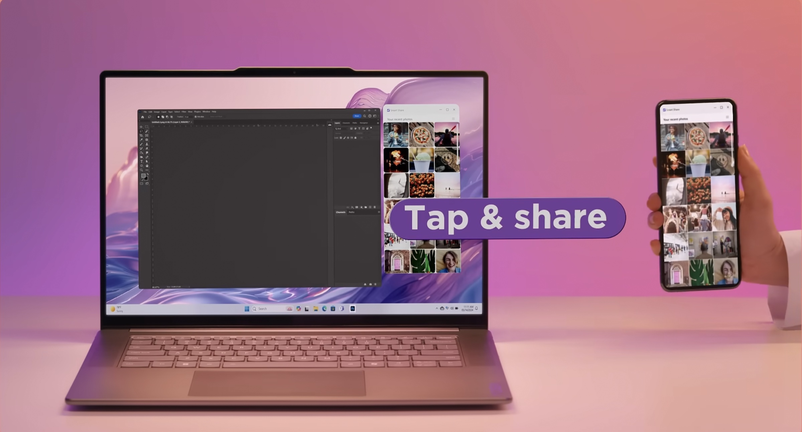

## Recognition

FY24/25 Lenovo Corporate Award winner in the Team Excellence category as part of the Project Fuji Aura experience.

<!-- TODO(mike): the full case study is ported from the Astro site in step 9. -->
