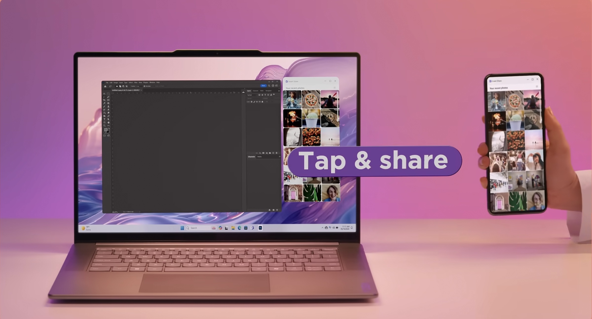

<!-- TODO: the 53-second Smart Share product film (needs video support in Notes). It shows a phone coming near the laptop, a "Drop photos to your PC" prompt, a photo dragged into Photoshop, and galleries synchronizing on both screens. -->

## Impact

- **11** Aura Edition devices at launch
- **+3** more PC lines after launch
- **Tap** became the Aura Edition signature gesture, from photos to pairing accessories

## Challenge

Getting a photo from your phone to your PC was possible, but never effortless. In Smart Share research, most people emailed photos to themselves, and many used chat or cloud apps instead.

- **81%** used email to move photos from phone to PC
- **69%** used chat apps
- **69%** used cloud applications

We asked a different question:

> What if moving something between devices felt like physically handing it over?

That question raised harder ones. Would people actually want to tap their phone against the side of their PC? Would an unfamiliar gesture feel natural, or just awkward?

And could it even be built? We needed hardware and engineering teams to tell us whether a laptop could reliably sense a tap at all. We had a vision, and a long road ahead.

<!-- TODO: the 40-second early-concept prototype film (needs video support in Notes). Filmed from above: a phone held next to a laptop opens the Magic Move window with the phone's recent photos, which are then dragged onto the laptop screen by touch. -->

## Process

### Collaboration

Magic Move sat between hardware, software and two outside partners, with teams spread across the US, China, Japan and Norway, so most of my job was keeping one experience intact across all of them. As the lead and primary designer, I owned the experience end to end, working with product management, hardware and software engineering, and our partners.

I presented the work regularly to our executive design director and to directors in product management and engineering, and it was shown to Lenovo’s CEO, Yang Yuanqing. The UX specification became the shared reference that kept those teams building the same thing.

### Defining the experience

We started with the experience, then wove in the technology, cost, and the hardware constraints of Lenovo PCs, iPhones and Android phones. Early work mapped user journeys and analyzed competitors. Then we envisioned how the tap should look and feel, and what it could do, focusing on three key experiences:

- **Multi-platform:** Android, iOS and Windows apps that behave as one experience.
- **Transfer photos:** drag photos from your phone straight into any app on your PC, and back again.
- **Tap to Launch:** tap your phone against the side of the PC and Smart Share opens instantly.

Six principles kept us honest: clear, familiar, cross-platform, simple, trustworthy and secure.

> The UI wasn’t the core idea. The interaction between the physical devices was the product.

### Low-fidelity flows

I started with experience mapping and low-fidelity flows for the core journey: connecting the phone and laptop, the first-run experience, tap to launch and photo transfer. These flows became the benchmark we tested against.

<!-- TODO(mike): what the map changed, e.g. a feature cut, a reordered flow, or a gap you found. -->

### Mid- to high-fidelity design

Mid-fidelity flows worked out tap to launch, drag and drop, proximity detection, and sharing photos and links. High-fidelity flows then took the whole journey end to end, including the mobile app.

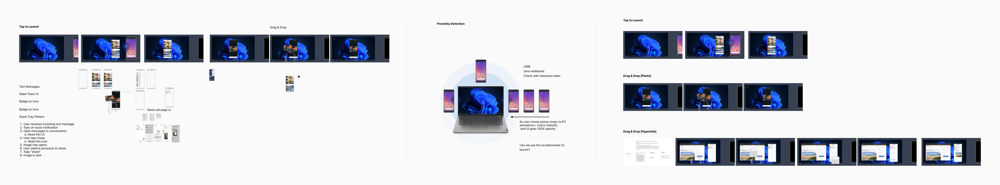

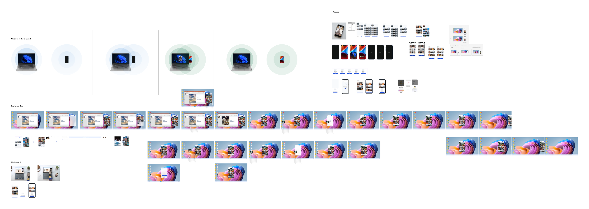

### Prototyping and research

We built a working prototype early: hold the phone near the laptop, and its photos appear on screen, ready to drag. Then we tested it across three studies, each answering a different question.

- **3** studies, 2023 to May 2024
- **37** participant sessions
- **14 of 16** rated PC-to-phone transfer very easy

**Will people understand the gesture?** _Guerrilla testing · Dec 2023 · 6 sessions_

- **What we saw:** People tapped at different angles, too lightly, or held the phone to the laptop like NFC. One worried about damaging the devices.
- **What changed:** The question became how to make the tap forgiving and teachable, so the design added tap guidance, success feedback, error recovery and first-use education.

**Does the interaction model work?** _Magic Move usability study with UX researcher Peggy He · 2023 · 15 hybrid workers and creatives_

- **What we saw:** Tapping made the link between devices clearest. Drag and drop worked, but seven people clicked a photo before finding they could drag it. People moved photos in batches.
- **What changed:** Tap became the primary path, with F11 as the fallback. Discoverability became the priority, multi-select joined the core flow, and the PC layout stopped mirroring the phone.

**What does it need for everyday use?** _Smart Share study led by Antoniea Richardson · May 2024 · 16 participants_

- **What we saw:** “Tap the phone” was too vague without a demonstration. 15 of 16 participants wanted control over photo access while the phone was locked.
- **What changed:** Onboarding got animated guidance, and permissions and an on/off control moved into the core experience.

Research never told us to drop the gesture. It showed what had to surround it: guidance, feedback, bulk actions, a PC-native layout and trust controls.

## Delivery

In September 2024, Smart Share launched at IFA in Berlin as a signature feature of the Lenovo Aura Edition, shipping on 11 PCs at once.

Through launch, I stayed close to engineering, answering questions as they came up and protecting the hero use cases from drift or redirection. This is what made it out the door.

<!-- TODO(mike): capture Smart Connect Tap to Launch screens and add them here. -->

### The shipped experience

One tap on the side of the laptop opens Smart Share with the phone’s recent photos.

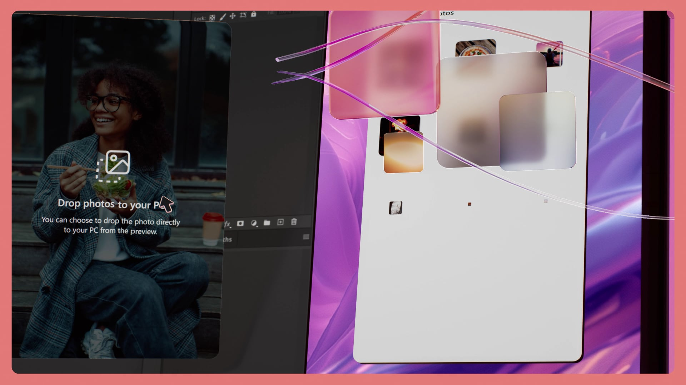

A clear prompt shows where the photo will land, so the first drag feels safe.

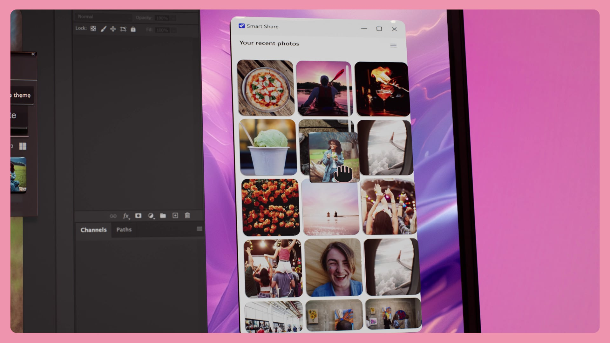

Photos go straight from the panel into Photoshop, a chat or anywhere else on the PC.

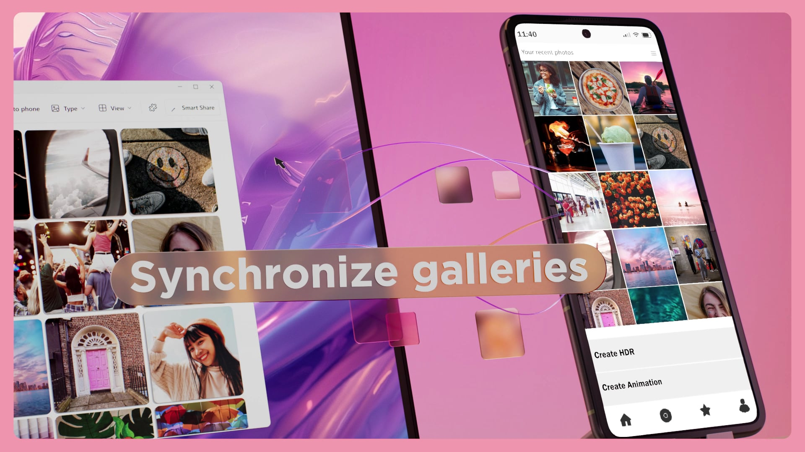

Phone and PC show the same photos, so moving between them stops being a task.

### Final delivery screens

The final screens take people from first run to their first transfer:

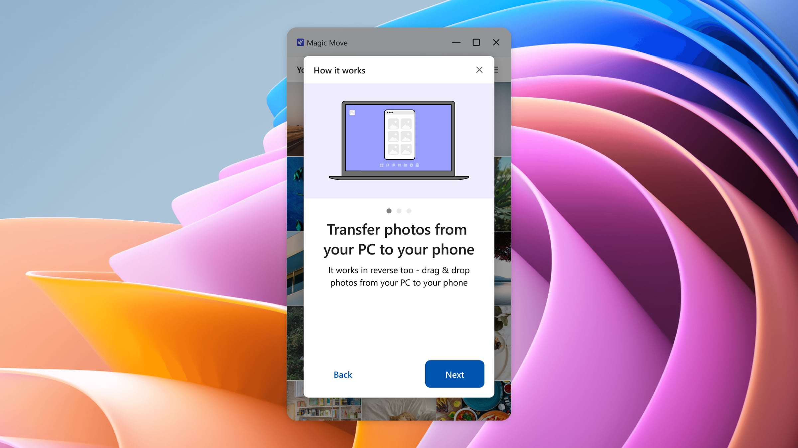

First run shows that photos move from PC to phone too, not only the other way.

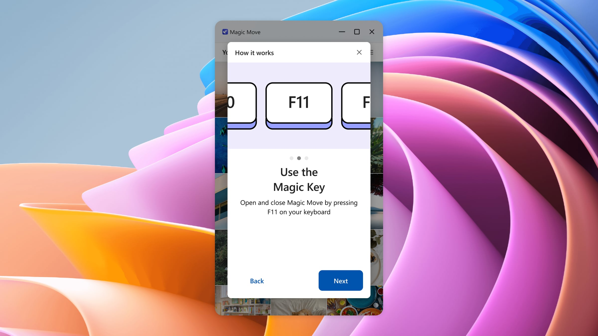

F11 opens and closes the app, the keyboard fallback the research called for.

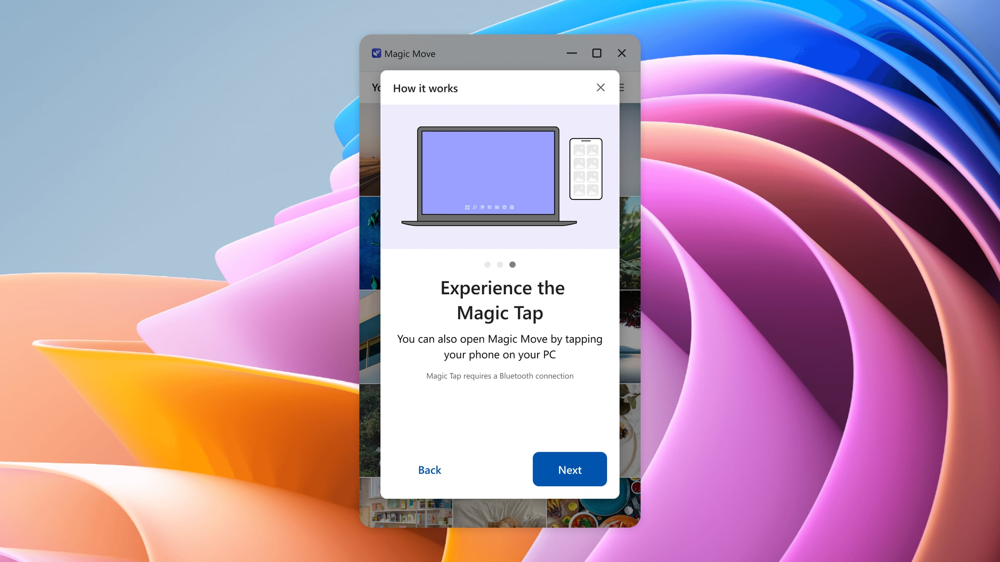

The tap is taught before people try it, so the first one works.

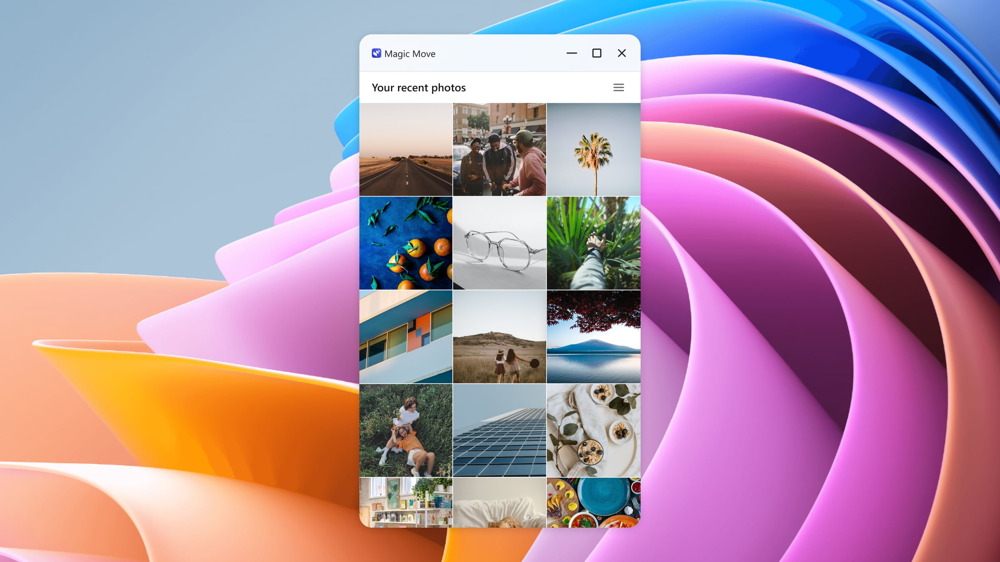

The phone’s latest photos, ready on the PC the moment the app opens.

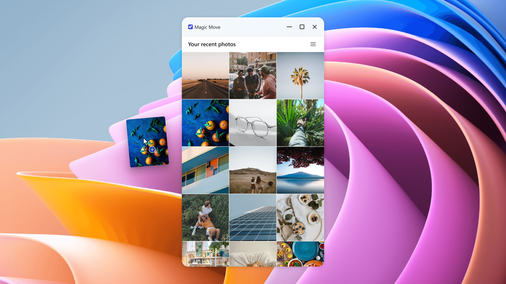

Photos lift off the grid with a clear drag state and drop anywhere on the PC.

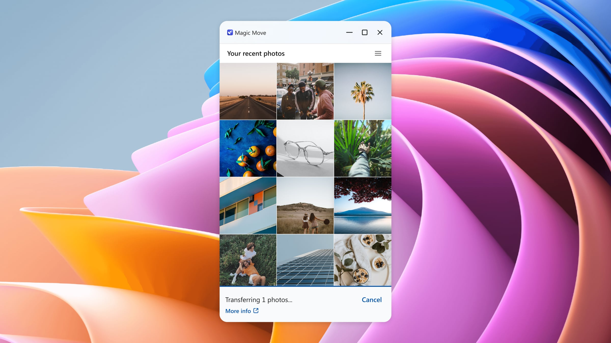

A progress line confirms the transfer, with a way to cancel.

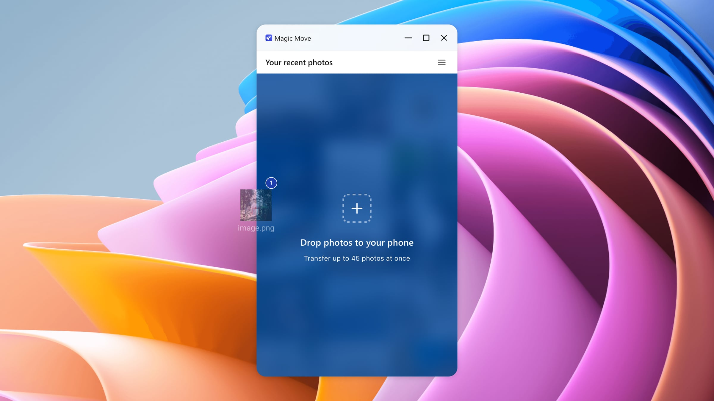

Drag a file onto the window and it becomes a drop zone for sending to the phone.

### The delivery file

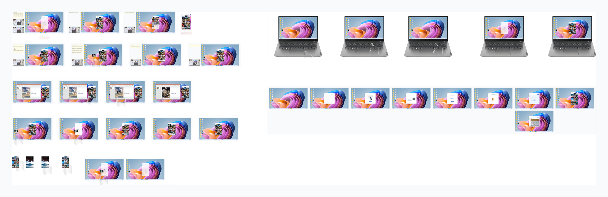

Every final screen and laptop render, one for each step of the flow, handed to engineering as the build reference.

## Outcome

Seeing the tap ship is still one of the proudest moments of my career. A gesture we first tested in six quick guerrilla sessions became the star of Lenovo’s product film.

> One tap, from a rough prototype on a desk to a signature feature of Lenovo’s Aura Edition PCs.

And it kept going. The tap became the main way people opened Smart Share. It spread to more consumer, commercial and all-in-one PCs, carried into Lenovo Smart Connect as Tap to Launch, and grew into Tap to Pair, connecting earphones, headsets and mice with the same gesture. The Aura Edition team’s work earned a Lenovo Corporate Award for Team Excellence.

I’m deeply grateful I got to lead the UX for it, and to the engineers, product managers, researchers and partners across four countries who made a tap feel like magic. Projects like this are why I love designing where hardware meets software.
